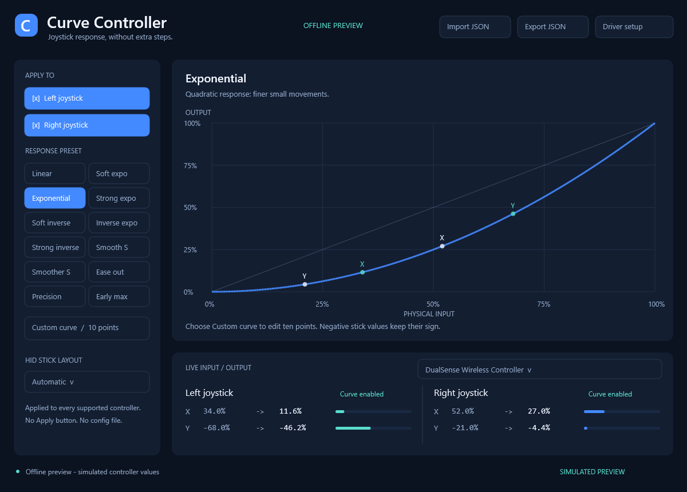
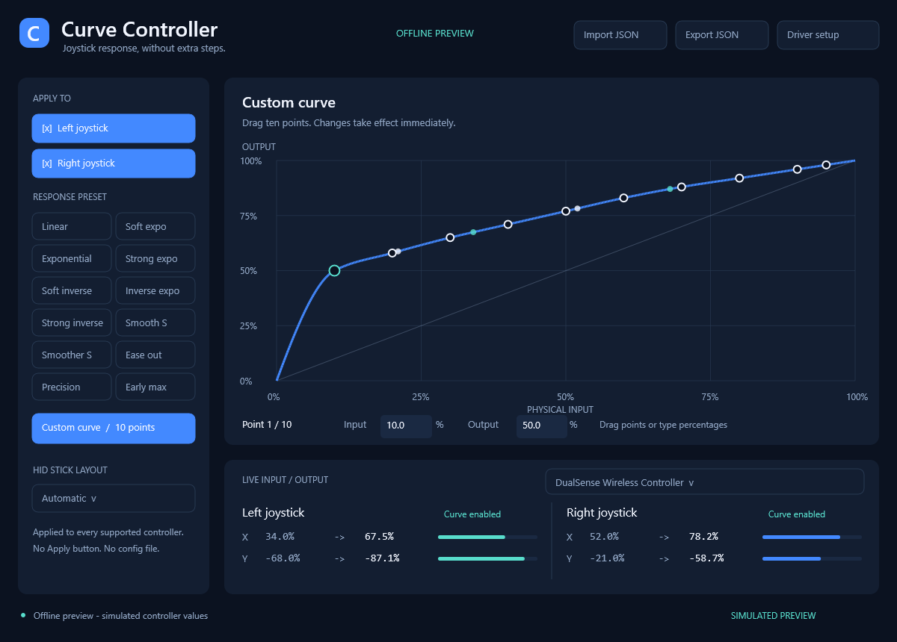

# Curve Controller - Real-Time Gamepad Joystick Response Curves

Change how your **left stick, right stick, or both** respond on Windows, with
instant presets, **distance-from-center response by default**, optional separate
X/Y response and a **ten-point custom curve editor**. Native C++17, a compact
interface, and low-level remapping through the
[Interceptor Gamepad & Controller kernel filter driver](https://github.com/TitanCSA/Interceptor-Gamepad-Controller).

**[Download](https://github.com/TitanCSA/Curve-Controller/releases/latest)** |
[Driver setup](https://github.com/TitanCSA/Curve-Controller/releases/latest/download/InterceptorSetup.exe) |
[Build from source](docs/BUILD.md) | [JSON examples](Examples)

The screenshot is an explicitly simulated preview, not a physical-device test.

## Install and start

1. Download the **Windows x64 ZIP** from [Releases](https://github.com/TitanCSA/Curve-Controller/releases/latest)
   and **extract all files**. It includes `CurveController.exe` and the matching
   **Gamepad & Controller** `InterceptorSetup.exe` (signed driver **1.0.13.0**).
2. Connect your controllers and close other capture/remapping apps. Run
   **InterceptorSetup.exe**, accept elevation and click **Install / reinstall**.
   If the combined Interceptor edition is installed, uninstall it first.
3. If setup requests it, use Windows **Restart**, then reopen **InterceptorSetup.exe**
   to finish pending device associations. Follow any further restart request until
   setup reports that the driver is running and its API responds.
4. Open **CurveController.exe** and accept elevation. It checks the driver before
   starting capture. If the driver is absent or unavailable, a dialog offers
   **Open driver setup** or **Continue without driver**.
5. Check **Left joystick**, **Right joystick**, or both, and choose a preset.
   **Distance from center** is selected by default; **X / Y separately** is also available.
   Changes are immediate, including when a previously observed stick is held still.

There is no Apply button. Unchecked sticks, buttons, triggers, hats and other
unedited report fields retain their physical values. Settings affect all
compatible captured controllers; the device menu selects only the live preview.
Closing the app releases capture and restores physical passthrough. A failed
connection is retried automatically; **Reconnect** is also available.

**Driver setup** opens the verified installer beside the app; opening the app never
installs a driver silently. The same [InterceptorSetup.exe](https://github.com/TitanCSA/Curve-Controller/releases/latest/download/InterceptorSetup.exe)
is a separate release download. If you choose only the standalone app EXE, put
this setup beside it; otherwise **Driver setup** opens the driver download in your
browser. An altered installer or another edition is rejected by its SHA-256 hash.
After setup finishes without a restart, choose **Reconnect** or reopen the app.
Without the driver you can still edit curves and import/export settings; physical
input remapping needs the installed driver. [Remove the driver](https://github.com/TitanCSA/Interceptor-Gamepad-Controller/blob/main/docs/INSTALLATION.md).

## Find your response

Choose **Linear**, three exponential curves, three inverse curves, **Smooth S**,
**Smoother S**, **Ease out**, **Precision**, or **Early max**. The graph plots the
actual response function, from **physical distance on the horizontal axis** to
**output distance on the vertical axis**, both from 0 to 100%.

- Linear preserves the original stick values exactly.
- Exponential gives finer control near the center; inverse exponential boosts
  small movements. The quadratic/square-root and cubic/cube-root pairs are inverses.
- Precision includes a 10% inner deadzone. Early max reaches 100% at 80% input.
- Custom provides **ten movable points**, plus fixed 0/0 and 100/100 anchors.
  Click a point and drag it, type its Input/Output percentages, or use arrow keys
  (Shift for smaller steps). Points cannot cross horizontally.

For **10% distance from center -> 50% distance**, select Custom, choose the first point,
and enter **Input 10**, **Output 50**. The smooth, shape-preserving custom curve
passes through the editable points and stays within the output range. Custom
curves can deliberately be non-monotone.

**Distance from center** transforms the length of the X/Y stick vector while
preserving its direction. For example, physical X=6%, Y=8% is 10% from center;
with the custom 10% -> 50% point it becomes X=30%, Y=40%, still pointing in the
same direction. Both modes update immediately, including a held stick.

Choose **X / Y separately** to apply the curve independently to each component,
using the absolute X/Y values on the graph and preserving their signs. Mode
selection is saved automatically and included in JSON exports. Older settings
without an explicit mode use the new distance-from-center default.

Distance is Euclidean: `sqrt(X*X + Y*Y)`, with 100% equal to full deflection along
one axis. Some square-gate devices can report diagonal lengths above 100%; those
outer values are preserved and displayed at 100% on the graph. Linear remains
exactly unchanged. Inverse curves can compensate a matching response curve in a
game; other game processing may still affect the final feel.

## Save, export and share

Preferences save automatically in **your Windows registry** at
`HKCU\Software\TitanCSA\CurveController`. No settings file is created beside the
application or in your documents. The last custom points are retained when you
try other presets. Uninstalling the driver does not remove these app preferences.

**Export JSON** saves an explicit, portable settings file; **Import JSON**
validates and immediately loads one. Nothing is executed from JSON. The
[Examples](Examples) folder contains linear, exponential, inverse, left-only,
right-only, custom 10% -> 50% and separate-X/Y examples. [JSON format](docs/JSON.md).

## Compatibility and live values

Works with supported **HID, XInput/XUSB, XInputHID and USB GIP** controller paths,
including compatible DS4/DualShock 4, DualSense, wired Xbox 360 and Xbox One/Series
profiles supported by the driver. It edits the existing physical input path;
it does not create a virtual gamepad or send keyboard/mouse events.

HID axes are decoded from their descriptor. Automatic mapping uses X/Y and a
common Z/Rz or Rx/Ry right-stick pair; use **HID stick layout** for ambiguous
descriptors. Unknown/proprietary controls are not guessed. Multiple report IDs
and repeated matching stick usages are retained; the four preview values show
the most recently observed matching component.

The live panel shows received physical values and the representable transformed
values accepted for forwarding by the driver. It is not an independent measurement
that a particular game consumed the report. No input yet is shown as `--`.
The graph's live markers have small **X** and **Y** labels in the same color as
their joystick's points in separate-X/Y mode. Distance mode shows one **Center**
marker per stick and a Center IN/OUT row. A Center marker appears only after both
physical components of an unambiguous stick pair are known. Split HID reports
use the latest observed physical counterpart and refresh the coupled output;
missing or ambiguous pairs pass through until a valid pair is available.
Windows, device firmware, connection type and game processing still affect delivery.

The capture loop is event driven: no FPS cap, fixed sleep or UI animation delay
is inserted in report processing. UI highlights animate separately; measured
stick values are displayed directly. This is not a claim of zero latency or
compatibility with every device. [Validation scope](docs/VALIDATION.md).

## Driver demo and project status

This is an **example of using Interceptor Gamepad & Controller and its C++ SDK**.
The app source is MIT licensed. Driver source is not included; its binaries have
[separate terms](DRIVER-BINARY-LICENSE.txt).

The driver's demo allowance is shared across applications of that edition and
starts when capture or controller monitoring begins. Closing or reinstalling
does not renew it. At expiry, remapping stops and physical input passes through;
use **Windows Restart** for a new allowance. Install the current Microsoft-signed **one-hour** driver package (kernel **1.0.13.0**). Restart Windows after upgrading from an older demo clock. Curve Controller uses the installed driver's actual policy. For the unrestricted driver, DM
**`titancsa`** on Discord.

Inspired by [GamePad Remapper](https://github.com/TitanCSA/GamePad-Remapper), a more
complete scripting/macro example for the same driver. Interceptor independently
evolves the workflow popularized by
[oblitum/Interception](https://github.com/oblitum/Interception); these projects are
not affiliated with oblitum and are not ABI-compatible with that original API.

## Intended use and responsibility

Created for legitimate customization, accessibility, development and testing.
You are responsible for your use of the application, driver and SDK, including
compliance with applicable law and software/service rules. The author does not
authorize unlawful use and disclaims warranties and liability to the extent
permitted by applicable law. See [LICENSE](LICENSE); nothing here excludes rights
or liability that cannot legally be excluded.
